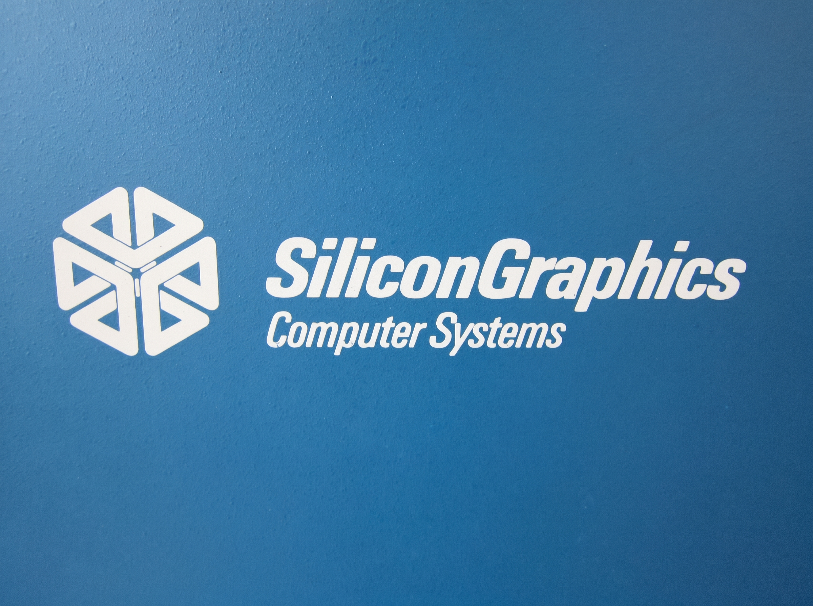
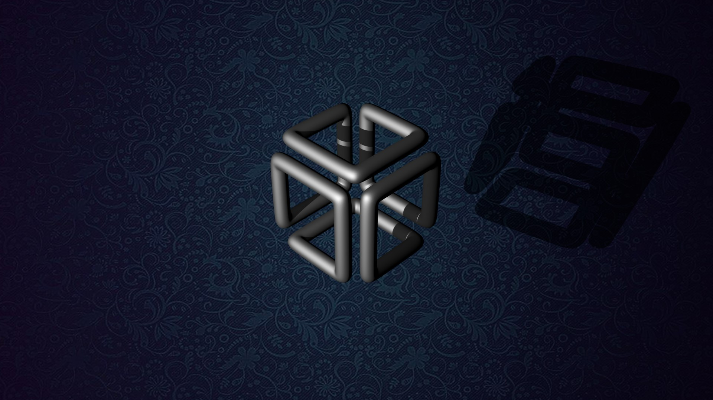

SGI IRIX Workstation (MaXX Interactive Desktop) on FreeBSD 15.1-RELEASE

-334c66?style=for-the-badge)
-76B900?style=for-the-badge&logo=nvidia&logoColor=white)

This repository contains idempotent automation scripts designed to transform an HP Z4 G4 workstation running FreeBSD 15.1-RELEASE into a modern Silicon Graphics (SGI) IRIX workstation, powered by MaXX Interactive Desktop (Octane 2.2.0).
The entire setup—from a fresh base OS installation to a fully hardware-accelerated SGI desktop environment—deploys in under 15 minutes.
---
Visual Preview & Screenshots
Live MaXX Interactive Desktop Session (`2560x1440`)
)
Live SGI IRIX `5Dwm` session running on FreeBSD 15.1-RELEASE (HP Z4 G4 / Quadro M4000 / ASUS PB278)
Boot & Login Artwork
UEFI Boot & Shutdown Splash	SDDM Login (`sgi_irix` Theme)
	
1920x1080 32-bit RGBA Framebuffer Splash	QHD 2560x1440 SGI Login & Desktop Background
---
Reference Hardware Configuration
These scripts have been calibrated, tested, and validated on the following hardware architecture:
Chassis / Motherboard: HP Z4 G4 Workstation (Intel C422 Chipset, UEFI BIOS)
Processor: Intel Xeon W-2140B (Skylake-W, 8 cores / 16 threads, hardware `ioat` DMA engine support)
Graphics Card: NVIDIA Quadro M4000 (8 GB GDDR5, Maxwell GM204GL architecture, PCI ID `10de:13f1`)
Monitor: ASUS PB278 running at native QHD `2560x1440` resolution
Locale & Keyboard: French / Swiss French (`fr_FR.UTF-8` locale with `ch fr` keyboard layout in X11 and SDDM)
---
Key Engineering & Technical Decisions
Running a rock-solid X11/Motif desktop on FreeBSD 15.1-RELEASE with an NVIDIA Maxwell GPU required solving several critical kernel and userland challenges:
1. NVIDIA Graphics Stability & Eliminating Kernel Panics (`trap_pfault`)
Strict 470 Driver Branch (`nvidia-driver-470`): While newer branches (such as 580) officially list Maxwell support, the legacy 470 production branch is completely free of GSP (GPU System Processor) firmware logic (which only exists on Turing/RTX and newer cards). Forcing GSP parameters (`EnableGpuFirmware=1`) on Maxwell hardware causes an immediate null-pointer dereference and kernel panic when starting the X server.
No `nvidia-drm-kmod`: On FreeBSD 15.1, the LinuxKPI DRM wrapper (`nvidia-drm-kmod`) can trigger a kernel page fault (`trap_pfault`) as soon as SDDM probes `/dev/dri/renderD128`. Since MaXX Interactive Desktop and XFCE are pure X11 environments, Xorg communicates directly with the GPU via `nvidia.ko` and `nvidia-modeset.ko` (`nvidia-kmod-470`), ensuring 100% stability without DRM overhead.
QHD Resolution Lock (`2560x1440`): Configured `/usr/local/etc/X11/xorg.conf.d/10-nvidia.conf` with `NoMaxResolutionCheck` and explicit `MetaModes` to prevent the driver from defaulting to unsupported 4K timings on the 27" ASUS monitor.
2. UEFI Framebuffer & SGI Boot/Shutdown Splash Screen
Diagonal/Skewed Image Fix: Although the console framebuffer runs at `2560x1440` (`efi_max_resolution="1440p"`), the HP Z4 G4 UEFI GOP/vt splash renderer expects a strict `1920x1080` stride during early boot.
Automated ImageMagick Pipeline: The base script automatically fetches the SGI boot artwork and converts it into a 32-bit RGBA PNG (`png32:`) scaled to `1920x1080`, enabling both boot (`splash=`) and poweroff (`shutdown_splash=`) visual screens alongside silent boot (`boot_mute="YES"`).
3. Linuxulator (Rocky Linux 9) & MaXX Octane 2.2.0 Tuning
ELF Binary Branding: Automatically identifies and brands (`brandelf -t Linux`) all true 64-bit ELF binaries inside `/compat/linux/opt/MaXX` without corrupting shell or Perl scripts.
Legacy `ncurses` v5 Compatibility: Creates required symbolic links from Rocky Linux 9 (`linux-rl9`) `libncurses.so.6` and `libtinfo.so.6` to `.so.5` inside the Linuxulator environment.
X11 Fonts & Preprocessor (`tradcpp`): Installs mandatory Motif/SGI bitmap fonts (`font-bh-lucidatypewriter`, `font-misc-misc`, `font-adobe`) and bridges FreeBSD's native `tradcpp` and `xrdb` into `/compat/linux/usr/bin/cpp` so Motif `.Xresources` load cleanly without syntax errors.
Native FreeBSD Toolchest Wrappers: Replaces hardcoded Linux scripts in the SGI Toolchest (`WEBBROWSER`, `EMAILCLIENT`, `MEDIAVIEWER`, `gr_osview2`, `Restart`, `Shutdown`) with native FreeBSD launchers (`firefox`, `thunderbird`, `vlc`, `btop`, and passwordless `sudo` power hooks).
---
Repository Structure
File	Description
`install-base.sh`	Phase 1: Sets up `sudo`, `sshd` root access, silent UEFI boot, SGI boot/shutdown splash screens, Intel microcode, `linux-rl9`, CUPS/USB rules, PipeWire audio, NVIDIA 470 stack, XFCE fallback desktop, and SDDM with the custom `sgi_irix` theme.
`install-maxx-interactive.sh`	Phase 2: Installs X11/Motif fonts, configures Linuxulator `ncurses5` symlinks, downloads/extracts MaXX Desktop Octane 2.2.0, brands ELF binaries, sets up the classic `redSGI` cursor, deploys FreeBSD Toolchest wrappers, and registers the SDDM session.
`myfirstdesktop.jpg`	Live screenshot of the HP Z4 G4 workstation running MaXX Interactive Desktop (`5Dwm`) on FreeBSD 15.1-RELEASE.
`sgi_desktop.jpg`	High-resolution SGI IRIX wallpaper used for both the SDDM login screen and the MaXX desktop background.
`SGI_splash.jpg`	Silicon Graphics logo used to generate the 32-bit RGBA UEFI boot and shutdown splash screen.
---
Deployment Guide
Prerequisites
Perform a fresh installation of FreeBSD 15.1-RELEASE (UEFI mode, ZFS or UFS).
Create a standard user named `administrateur` and add it to the `wheel`, `operator`, and `video` groups.
Log in as `root` and update the base system before running the scripts:
```sh
freebsd-update fetch install
reboot
```
Phase 1: Base System, NVIDIA 470 & SDDM Setup
Run the first script as `root`:
```sh
chmod +x install-base.sh
./install-base.sh
reboot
```
Upon reboot, you will see the centered SGI splash screen followed by the SDDM login manager themed in SGI IRIX colors at `2560x1440`.
Phase 2: MaXX Interactive Desktop Installation
Log in via SSH (PuTTY) or a local terminal as `root` and execute the second script:
```sh
chmod +x install-maxx-interactive.sh
./install-maxx-interactive.sh
```
Once completed, select "MaXX Interactive Desktop" from the SDDM session menu at the top left and log in as `administrateur`.
---
Credits & Acknowledgments
MaXX Interactive Desktop by Eric Masson and the MaXX team for preserving and modernizing the SGI IRIX `5Dwm` and Indigo Magic Desktop experience.
The FreeBSD Project for the rock-solid 15.1-RELEASE kernel and Linuxulator compatibility layer.
License
The installation scripts and configuration wrappers in this repository are released under the MIT License.
Silicon Graphics, IRIX, Indigo Magic, and the SGI cube logo are registered trademarks of their respective owners. MaXX Interactive Desktop binaries are subject to their own respective license terms.
